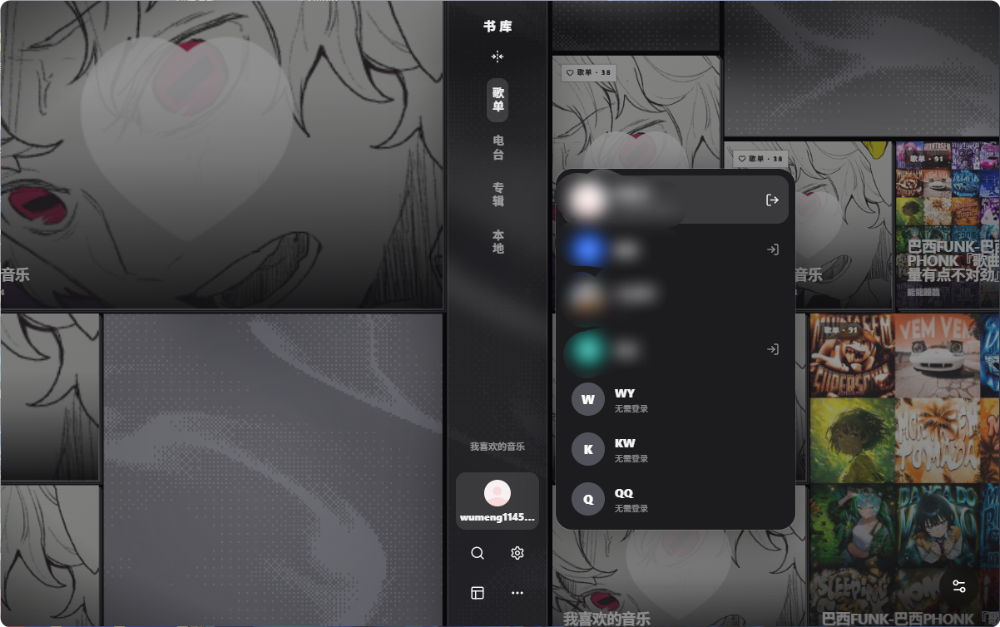
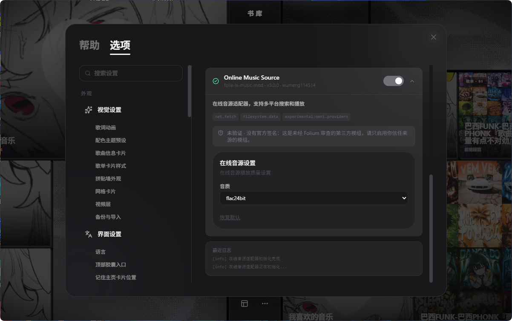

# folia-lx-music-mod

在线音源适配器 Folia 模组。支持多平台搜索和播放。

## 截图

## 功能

- 多平台独立搜索（WY / KW / QQ）
- 在线播放
- 封面显示
- 歌词显示（WY / QQ）
- 音质选择

## 安装

将模组 zip 文件拖入 Folia 模组面板即可安装。

## 网络请求说明

本模组所有网络请求均：
- 仅使用 HTTPS
- 仅访问固定的域名白名单
- 限制重定向次数（最多 3 次）
- 限制响应大小（最多 5MB）
- 重定向时不转发原始请求头

白名单域名：
- `music.163.com` — WY 搜索/详情/歌词
- `c.y.qq.com` / `y.qq.com` — QQ 搜索/封面/歌词
- `search.kuwo.cn` / `img1.kuwo.cn` — KW 搜索/封面
- `oiapi.net` — 播放URL获取（QQ 播放需要用户填写自己申请的 OIAPI 密钥）
- `p1.music.126.net` / `p2.music.126.net` — WY 封面CDN

**本模组不下载或执行任何远程代码。** 所有播放逻辑内置在模组代码中。

## 声明

本模组代码由 Claude AI 生成。

## 免责声明

本模组仅供学习和技术研究使用。使用者需自行承担相关法律责任。

播放地址来自第三方解析接口，可能随时失效；本模组不保证第三方服务的可用性。

## 许可证

MIT License
